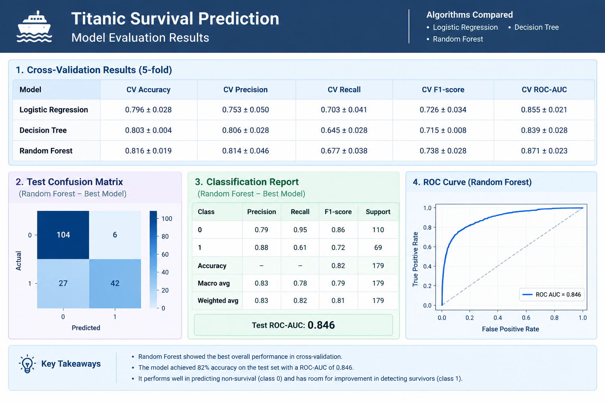

# titanic-survival-prediction.
A beginner-friendly machine learning project that predicts whether a Titanic passenger survived using passenger information. This project compares Logistic Regression, Decision Tree, and Random Forest classifiers and evaluates them using cross-validation and test-set metrics
Project Overview
- Problem type: Supervised learning — binary classification
- Target: survived (1 = survived, 0 = did not survive)
- Dataset: Titanic dataset loaded with Seaborn
- Models compared: Logistic Regression, Decision Tree, Random Forest
- Train/test split: 80% training / 20% testing
- Validation: Stratified 5-fold cross-validation
- Libraries: Python, Pandas, Seaborn, Scikit-learn
Results Dashboard
## Results Dashboard

The dashboard summarizes cross-validation results and the Random Forest test-set evaluation.
Features Used
Feature	Description
pclass	Passenger class
sex	Passenger sex
age	Passenger age
sibsp	Number of siblings/spouses aboard
parch	Number of parents/children aboard
fare	Passenger fare
embarked	Port of embarkation

Workflow
1. Load the Titanic dataset using Seaborn.
2. Select relevant input features and the survival target.
3. Impute missing numerical values with the median and categorical values with the most frequent category.
4. Standardize numerical features and one-hot encode categorical features.
5. Split data into training and test sets using stratification.
6. Compare three models using stratified 5-fold cross-validation.
7. Evaluate the selected Random Forest model on the held-out test set.
8. Review results and identify potential improvements.
Preprocessing is implemented inside a Scikit-learn Pipeline and ColumnTransformer, helping prevent data leakage during cross-validation.
Algorithms Compared
1. Logistic Regression
A fast, interpretable baseline for binary classification. It estimates survival probability but may not capture complex non-linear patterns without additional feature engineering.
2. Decision Tree
Learns decision rules by splitting data into groups. It can model non-linear relationships and is easy to interpret, but can overfit if not controlled.
3. Random Forest
Combines predictions from many decision trees. It can capture complex patterns and often generalizes better than a single tree, though it is less interpretable.
Model Evaluation Results
The values below are the results shown in the project's evaluation dashboard.
5-Fold Cross-Validation
Model	Accuracy	Precision	Recall	F1-score	ROC-AUC
Logistic Regression	0.796 ± 0.028	0.753 ± 0.050	0.703 ± 0.041	0.726 ± 0.034	0.855 ± 0.021
Decision Tree	0.803 ± 0.004	0.806 ± 0.028	0.645 ± 0.028	0.715 ± 0.008	0.839 ± 0.028
Random Forest	0.816 ± 0.019	0.814 ± 0.046	0.677 ± 0.038	0.738 ± 0.028	0.871 ± 0.023

Values are mean ± standard deviation across five folds. These are the reported dashboard values; rerun the code in your environment to reproduce and verify them.
Random Forest Test-Set Results
- Accuracy: 0.82 (approximately 82%)
- ROC-AUC: 0.846
- Test samples: 179
Confusion Matrix
Rows are actual labels and columns are predicted labels. Class 0 means did not survive and class 1 means survived.
	Predicted 0	Predicted 1
Actual 0	104	6
Actual 1	27	42

Classification Report
Class / Metric	Precision	Recall	F1-score	Support
Class 0 — Did not survive	0.79	0.95	0.86	110
Class 1 — Survived	0.88	0.61	0.72	69
Macro average	0.83	0.78	0.79	179
Weighted average	0.83	0.82	0.81	179

Key Findings
- Random Forest had the strongest overall cross-validation results in this comparison, including the highest mean accuracy, F1-score, and ROC-AUC.
- The model correctly identified many non-survivors (class 0), with recall of 0.95.
- Survivor recall (class 1) was 0.61, meaning the model missed a portion of actual survivors. Further tuning may improve this.
- Accuracy alone does not tell the full story; precision, recall, F1-score, ROC-AUC, and the confusion matrix provide a more complete evaluation.
Installation
Install the required packages:
python -m pip install pandas seaborn scikit-learn
Optional Windows virtual environment setup:
python -m venv .venv
.venv\Scripts\activate
python -m pip install pandas seaborn scikit-learn
The first run of sns.load_dataset("titanic") may require an internet connection to download the dataset.
Run the Project
1. Save the model code in titanic_survival_prediction.py.
2. Install the required packages.
3. Run:
python titanic_survival_prediction.py
The script prints cross-validation metrics, the confusion matrix, the classification report, and test ROC-AUC to the console.
Suggested Repository Structure
titanic-survival-prediction/
├── README.md
├── titanic_survival_prediction.py
├── images/
│   └── titanic-model-evaluation.png
└── requirements.txt
Create a requirements.txt file containing:
pandas
seaborn
scikit-learn
Place the dashboard image in the images folder with the filename titanic-model-evaluation.png. GitHub will then display the image in this README.
Limitations and Future Improvements
- Tune hyperparameters using GridSearchCV or RandomizedSearchCV on training data.
- Try meaningful additional features, such as family size or travelling alone.
- Compare training, cross-validation, and test performance to check for overfitting.
- Review class-specific recall and choose metrics that match the project goal.
- Investigate feature importance while remembering that associations do not establish causation.
Ethical Considerations
This is an educational project based on a historical dataset. Its patterns reflect the circumstances and social inequalities of the Titanic disaster. Predictions are probabilistic and should not be used for real-world safety decisions or judgments about individuals.
References
- Seaborn documentation
- Scikit-learn: Model selection and evaluation
- Scikit-learn: Pipelines and composite estimators
- Scikit-learn: Model evaluation
Project: Week 3 — Predictive Modeling and Algorithm Selection
Topic: Titanic Passenger Survival Prediction Using Machine Learning
